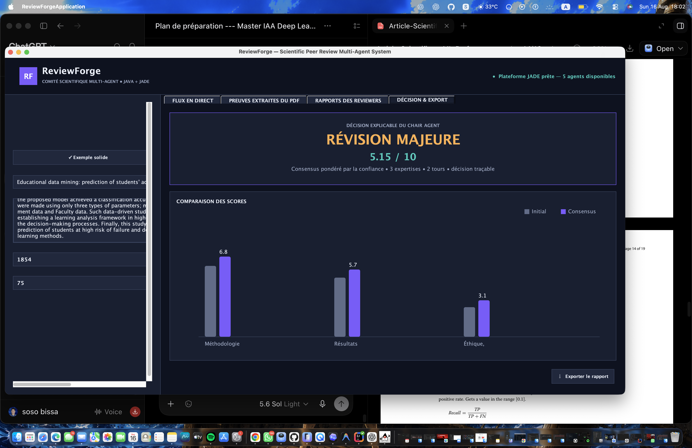
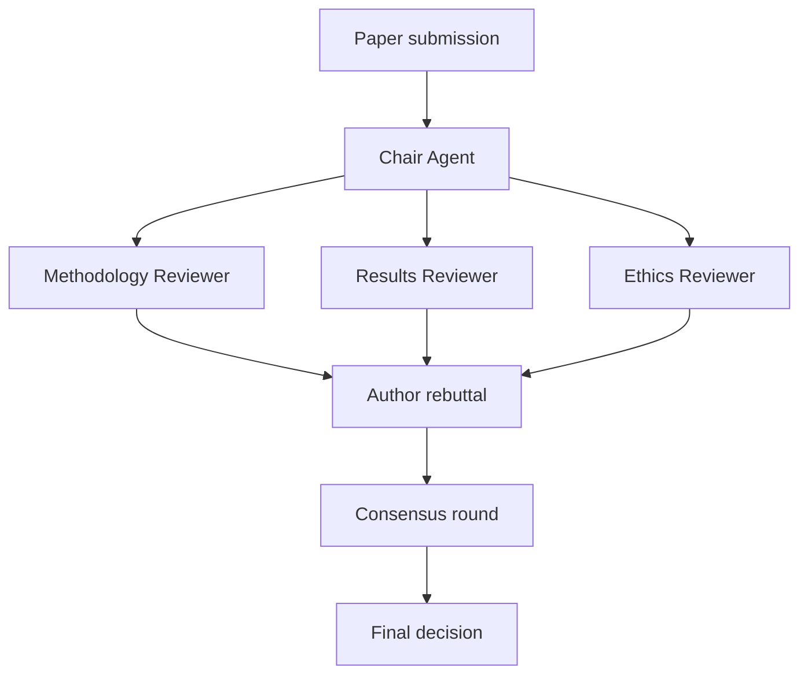

# ReviewForge

> An explainable multi-agent system that simulates scientific peer review with Java, JADE, Maven, and PDFBox.

[](https://openjdk.org/)
[](https://jade.tilab.com/)
[](https://maven.apache.org/)

ReviewForge reproduces the main stages of an academic review committee. Specialized agents independently examine a scientific paper, an author agent answers their concerns, and a chair agent coordinates a second evaluation round before publishing a traceable final decision.

## Screenshot

Click the preview to open the full-resolution screenshot.

[](docs/screenshots/reviewforge-dashboard.png)

## Why ReviewForge?

Many multi-agent demonstrations only distribute independent tasks. ReviewForge models an actual peer-review workflow:

1. The `ChairAgent` sends the submitted paper to three specialist reviewers.
2. Each reviewer returns a score, confidence level, strengths, and concerns.
3. The `AuthorAgent` produces a structured rebuttal and revision commitments.
4. The reviewers reconsider their assessments during a consensus round.
5. The chair calculates an explainable, confidence-weighted final decision.

## Agents

| Agent | Responsibility |
|---|---|
| `ChairAgent` | Coordinates the workflow, collects reviews, and publishes the final decision |
| `MethodologyReviewerAgent` | Evaluates the protocol, dataset, baseline, and statistical validation |
| `ResultsReviewerAgent` | Evaluates results, comparisons, limitations, and reproducibility |
| `EthicsReviewerAgent` | Evaluates ethics, bias, privacy, and anonymization |
| `AuthorAgent` | Responds to criticism and proposes concrete revisions |

Agents communicate through JADE `ACLMessage` objects using `REQUEST`, `INFORM`, and `CANCEL` performatives, a shared conversation ID, message ontologies, and serialized Java domain objects.

## Main Features

- Load a scientific paper directly from a PDF file.
- Extract its title, abstract, dataset size, and reported accuracy.
- Detect baselines, statistical tests, limitations, ethics statements, and anonymization.
- Attach the source page and sentence as evidence for each detected criterion.
- Follow the live state of all five agents.
- Inspect a timestamped log of ACL communications.
- Compare specialist scores before and after rebuttal and consensus.
- Produce an explainable final recommendation.
- Export the complete review report as Markdown.
- Run two built-in scenarios without loading a PDF.

## Review Workflow



## Technology Stack

| Technology | Purpose |
|---|---|
| Java 17+ | Application and agent logic |
| JADE 4.6.5 | Multi-agent platform and ACL communication |
| Apache PDFBox 3.0.4 | PDF text extraction and evidence discovery |
| Swing | Desktop dashboard |
| Maven | Dependency management, compilation, and execution |

## Requirements

- JDK 17 or newer
- Apache Maven 3.9 or newer

## Run the Application

```bash
git clone https://github.com/DevOam/reviewforge-multi-agent-peer-review.git
cd reviewforge-multi-agent-peer-review
mvn clean compile exec:java
```

When the dashboard opens:

1. Load a scientific PDF or select one of the built-in examples.
2. Check the extracted evidence.
3. Start the multi-agent analysis.
4. Follow the reviews, rebuttal, consensus, and final decision.
5. Export the generated report if required.

> Scanned image-only PDFs require OCR. ReviewForge reports that no text was found instead of fabricating extracted results. Automatic detections are based on transparent rules and should be verified against the cited evidence.

## Open in IntelliJ IDEA

1. Select **Open** and choose the repository folder.
2. Accept the Maven project import.
3. Select JDK 17 or newer as the project SDK.
4. Run `ReviewForgeApplication`.
5. Wait until the dashboard reports that the JADE platform is ready.

## Project Structure

```text
src/main/java/ma/fpo/iaa/reviewforge/
├── ReviewForgeApplication.java
├── agents/
│   ├── AbstractReviewerAgent.java
│   ├── AuthorAgent.java
│   ├── ChairAgent.java
│   ├── EthicsReviewerAgent.java
│   ├── MethodologyReviewerAgent.java
│   └── ResultsReviewerAgent.java
├── domain/
│   ├── ConsensusContext.java
│   ├── Evidence.java
│   ├── Paper.java
│   ├── Protocol.java
│   ├── Rebuttal.java
│   ├── Review.java
│   └── ReviewBundle.java
├── service/
│   ├── PdfExtractorCli.java
│   └── PdfPaperExtractor.java
└── ui/
    ├── ReviewForgeEvents.java
    └── ReviewForgeFrame.java
```

## Explainability

The system uses deterministic and inspectable rules. Every reviewer score is accompanied by a confidence value, strengths, concerns, and evidence extracted from the paper. The dashboard also shows how scores change after the rebuttal, making the final recommendation easier to justify during a demonstration or evaluation.

## License

This project was created for educational and academic use as part of the Master's program in Artificial Intelligence and Applications.

